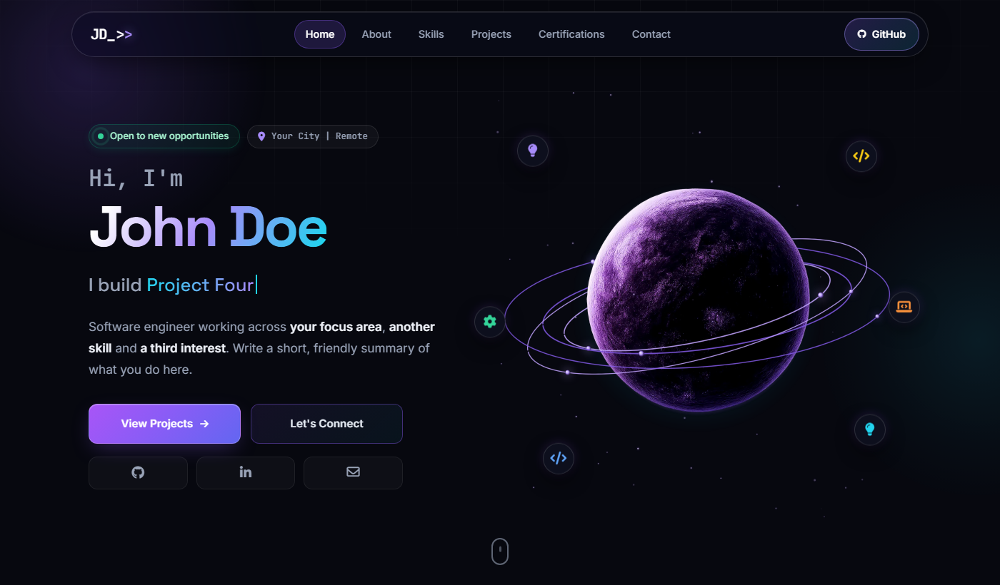

<h1 align="center">Dev Portfolio Template</h1>

<p align="center">
  A modern, responsive developer portfolio built with plain HTML, CSS and JavaScript.<br>
  No frameworks. No build step.
</p>

<p align="center">
  <kbd>&nbsp;HTML5&nbsp;</kbd> <kbd>&nbsp;CSS3&nbsp;</kbd> <kbd>&nbsp;JavaScript&nbsp;</kbd> <a href="LICENSE"><kbd>&nbsp;License&nbsp;</kbd></a>
</p>

<p align="center">
  
</p>

---

## ✨ Features

- Floating glass navbar with a slide-in mobile menu
- Hero with a typewriter headline and an animated canvas planet with orbiting rings
- Scrolling tech marquee
- About, Skills, Projects, Certifications and Contact sections
- Filterable project cards, each with its own preview design
- Scroll progress bar, smooth anchor scrolling and reveal-on-scroll animations
- Cursor-spotlight card effects and polished button hovers
- Responsive down to small phones
- Accessible: skip link, ARIA labels, keyboard-friendly menu and reduced-motion support

## 🛠️ Tech Stack

| Layer | Used |
|-------|------|
| Markup | HTML5 |
| Styling | CSS3 (custom properties, grid, flexbox, keyframes) |
| Behaviour | Vanilla JavaScript (Canvas API, IntersectionObserver) |

## 📁 Project Structure

```
├── index.html       # Page markup and all sections
├── style.css        # Design tokens, layout, components, responsive rules
├── script.js        # PROFILE config, menu, scroll effects, typing, canvas planet
└── assets/
    ├── planet.webp  # Planet image used in the hero
    └── preview.png  # Screenshot used in this README
```

## 🚀 Getting Started

```bash
git clone https://github.com/Strike2Verse/dev-portfolio-template.git
cd dev-portfolio-template
```

Open `index.html` in your browser, or serve it locally:

```bash
npx serve .
```

## 🎨 Customisation

1. Replace the placeholder name, bio and links in `index.html`.
2. Change the colors in the `:root` block at the top of `style.css`.
3. Add your own projects and certifications to their sections.

## 📄 License

Released under the terms of the [LICENSE](LICENSE) file.
